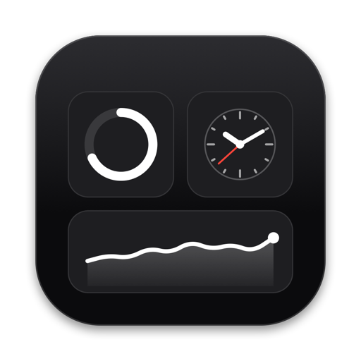
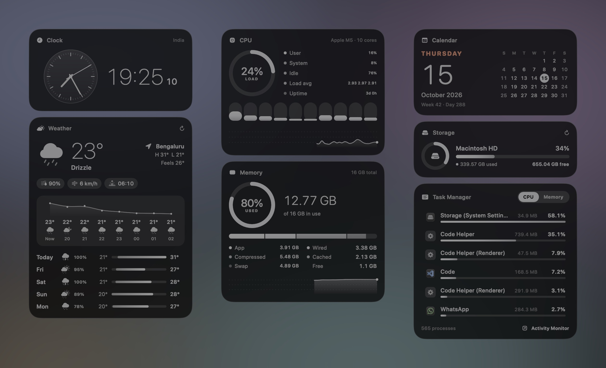

<div align="center">



# Better Widgets

**Beautiful, minimal desktop widgets for macOS.**<br>
Clock · Calendar · Weather · CPU · Memory · Storage · Task Manager

[](https://github.com/PranshavShelat/Better_Widgets_mac/releases/latest/download/Better-Widgets.zip)
&nbsp;
[](https://pranshavshelat.github.io/Better_Widgets_mac/)
&nbsp;
[](https://buymeacoffee.com/pranshav)

[](https://github.com/PranshavShelat/Better_Widgets_mac/releases/latest)
[](#requirements)
[](https://developer.apple.com/xcode/swiftui/)
[](LICENSE)

<br>



</div>

<br>

## ✦ Why Better Widgets

Each card is its own desktop widget that you can **drag anywhere, resize from the corner, and click to open** the matching app. It looks native and stays out of your way.

|  |  |
| --- | --- |
| 🕰 **Clock** | Analog, digital or both, with a smooth second hand and your country name |
| 📅 **Calendar** | Big date, month grid and week number. Click to open Calendar |
| 🌦 **Weather** | Now, hourly graph and 5-day forecast for your location or any city |
| ⚙️ **CPU** | Live load ring, per-core bars, history graph and uptime |
| 🧠 **Memory** | Used / app / wired / compressed / cached / swap breakdown |
| 💾 **Storage** | Used and free space for every drive |
| 📋 **Task Manager** | Top processes by CPU or memory. Quit or force quit right from the card |

**Feels like part of macOS**
- Stays put when you click the wallpaper to show the desktop, and hides itself during Mission Control
- **Arrange** places every card in free space and never covers Apple's widgets or your desktop files
- Edit mode for removing, adding back and auto-arranging cards (grid, column or row)
- Themes, Liquid Glass / Frosted / Black materials, light and dark mode
- Lightweight: no Dock icon, no account, no tracking

<br>

## ⬇ Install

1. **[Download Better-Widgets.zip](https://github.com/PranshavShelat/Better_Widgets_mac/releases/latest/download/Better-Widgets.zip)** and unzip it.
2. Drag **Better Widgets** into your **Applications** folder.
3. Open it. macOS shows **"Better Widgets" Not Opened**: *"Apple could not verify…"*. Click **Done**, not Move to Trash.
4. Go to **System Settings → Privacy & Security**, scroll down, and click **Open Anyway** next to Better Widgets. Confirm with your password.

You only need to do step 4 once. The warning appears because the app isn't from the App Store or signed with a paid Apple developer certificate, not because anything is wrong with it. The full source code is in this repo.

<details>
<summary><b>Prefer Terminal?</b></summary>

```sh
xattr -dr com.apple.quarantine "/Applications/Better Widgets.app"
open "/Applications/Better Widgets.app"
```
</details>

### Requirements

- macOS 15 Sequoia or later (built and tested on macOS 27)
- Apple silicon or Intel Mac

<br>

## ✦ Getting started

Better Widgets runs in the background without a Dock icon. Look for the **gauge icon in the menu bar**: it has Settings, Edit Widgets, Arrange and Quit.

1. **Allow Accessibility** when asked (recommended). It lets **Arrange** see your desktop files so cards never cover them or their names. Turn it on under *System Settings → Privacy & Security → Accessibility*.
2. **Pick a weather location.** Click **Use My Location** on the Weather card, or **Choose City…** to search.
3. **Arrange.** Menu-bar icon → **Arrange → Grid**, and every card goes into free space.

<br>

## ✦ Using it

| To… | Do this |
| --- | --- |
| Open the related app | **Click** a card: Clock, Calendar, Weather, Activity Monitor (CPU / Memory) or Storage settings |
| Move | **Drag** the card |
| Resize | Hover, then drag the **↖↘ grip** at the bottom-right corner. Or right-click → **Size** |
| Remove | Right-click → **Remove**, or **−** in Edit mode |
| Add back | Menu-bar icon → **Widgets**, or **+ Add** in Edit mode |
| Rearrange | Menu-bar icon → **Arrange** → Grid / Column / Row |
| Quit a process | Hover a Task Manager row → **✕** → **Quit**. Right-click for **Force Quit** |

**Edit mode** (menu-bar icon → *Edit Widgets…*, or right-click any card) brings the cards above your windows and shows remove buttons, resize grips and an arrange bar.

**Arrange** never covers Apple's widgets, other desktop widgets, or your desktop files and their names. If the cards don't fit, it shrinks them evenly. If they still don't fit, it hides the last cards in your order and tells you which ones.

<details>
<summary><b>All settings</b></summary>

| Tab | Options |
| --- | --- |
| Appearance | Theme, card material (Liquid Glass / Frosted / Black), light or dark, corner radius, card width, high-usage colours |
| Modules | Show or hide each card, and the order Arrange uses |
| Clock & Date | Analog / digital / both, 24-hour time, seconds, smooth second hand, date format, month calendar, week number |
| Weather | Current location or city search, °C / °F, hourly graph, 5-day forecast |
| System | Refresh rate, per-core bars, history graphs, external drives, process count, allow quitting processes |
| Window | Desktop / normal / always-on-top, lock positions, click-through, hide in Mission Control, launch at login |

</details>

<br>

## ✦ Privacy

- Everything runs on your Mac; there are no accounts, analytics or tracking.
- Weather is the only network request: only the search text or coordinates go to [Open-Meteo](https://open-meteo.com).
- **Accessibility** is used only to read where your desktop icons are. **Location** is used only if you choose *Use My Location*.

<br>

## ✦ Build from source

You need the Xcode Command Line Tools (`xcode-select --install`).

```sh
git clone https://github.com/PranshavShelat/Better_Widgets_mac.git
cd Better_Widgets_mac
./scripts/make-signing-identity.sh   # one time: a local signing key so permissions survive rebuilds
./build-app.sh --install             # build and install to ~/Applications
```

<details>
<summary><b>More build options</b></summary>

```sh
./build-app.sh --run       # build into ./build and launch
./build-app.sh --release   # universal (Apple silicon + Intel) zip for GitHub Releases
swift build && .build/debug/BetterWidgets --selftest "London"          # print every data source once
.build/debug/BetterWidgets --snapshot preview.png "London"              # render all cards to a PNG
```

- `make-signing-identity.sh` creates a self-signed key, "Better Widgets Local Signing", in your login keychain. The first build asks to use it: enter your login password and click **Always Allow**. Remove it with `security delete-identity -c "Better Widgets Local Signing"`.
- With only the Command Line Tools installed, the script builds against the macOS 26 SDK. On the macOS 27 SDK, SwiftUI's `@State` is a macro whose plugin ships only with full Xcode.

</details>

<br>

## ✦ Troubleshooting

<details>
<summary><b>"Better Widgets" Not Opened / Apple could not verify it</b></summary>

Click **Done**, then go to *System Settings → Privacy & Security* and click **Open Anyway**, as in step 4 of [Install](#-install). If you clicked Move to Trash, just download it again.
</details>

<details>
<summary><b>Arrange covers my desktop files</b></summary>

Arrange needs Accessibility to see desktop icons. Turn on Better Widgets under *System Settings → Privacy & Security → Accessibility*. If an old entry is there, remove it with **−** and add the app again.
</details>

<details>
<summary><b>Cards show up in Mission Control</b></summary>

Check *Settings → Window → Hide in Mission Control*. To see whether the app noticed Mission Control:

```sh
/usr/bin/log show --last 10m --predicate 'subsystem == "io.github.pranshavshelat.betterwidgets"' --style compact
```
</details>

<details>
<summary><b>Weather can't find my city</b></summary>

Add a region or country, e.g. `Portland, OR` or `Paris, France`, then pick from the list.
</details>

<details>
<summary><b>Uninstall</b></summary>

```sh
pkill -x BetterWidgets
rm -rf "/Applications/Better Widgets.app" ~/Applications/"Better Widgets.app"
defaults delete io.github.pranshavshelat.betterwidgets
```

Then remove Better Widgets from *System Settings → Privacy & Security → Accessibility*.
</details>

<br>

## ✦ Support

Better Widgets is free and always will be. If it made your desktop a little better, you can [**buy me a coffee ☕**](https://buymeacoffee.com/pranshav). Starring the repo ⭐ helps a lot too.

<br>

## ✦ Credits & license

- Weather data by [Open-Meteo.com](https://open-meteo.com), licensed under [CC BY 4.0](https://creativecommons.org/licenses/by/4.0/).
- Released under the [MIT License](LICENSE) © 2026 Pranshav Shelat.
- Better Widgets is an independent project and is not affiliated with or endorsed by Apple Inc. macOS and Mac are trademarks of Apple Inc., registered in the U.S. and other countries.
